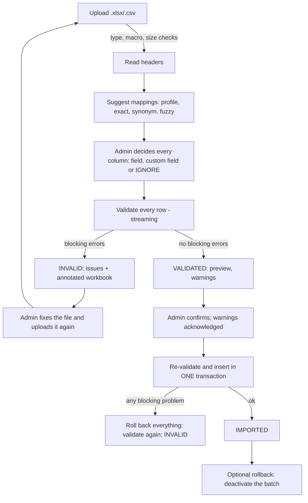

# Organization Personnel & Identity Management

Built 2026-11-01 (migration 0017, decision D-016). Code: `services/core_api` (backend) and
`website/` (Organization Admin and Supervisor web app). Face recognition is **not** part of this
module (see "Future identity integration").

## 1. What it is

Each campus keeps its own records of the people associated with it: students, faculty, employees,
staff, management, contractors, visitors and any category the campus defines. Personnel are
**organizational records, not login accounts**. A record or a photo is never proof of who appears on
a camera.

Parts of the module:
- **Personnel Directory:** search, filters, details, registration, editing, deactivation, history.
- **Excel/CSV import:** template, flexible column mapping, validation, annotated error workbook,
  all-or-nothing confirmation, history and rollback.
- **Restricted-Area Access:** which people may enter which restricted areas, and when.

## 2. Who may do what

| Action | Org Admin | Supervisor | Guard | Super Admin |
|---|---|---|---|---|
| Directory: list, search, filter | yes (with email/phone) | yes (basic columns, no contact details) | no | no |
| Person details | full record | basic details only | no | no |
| Register a person (form) | **yes, only role** | no | no | no |
| Excel/CSV import (template, upload, mapping, validation, confirm, rollback, discard, history) | **yes, only role** | no | no | no |
| Edit, deactivate, reactivate | yes | no | no | no |
| Person history (audit) | yes | no | no | no |
| Photo: upload, view, remove | yes | **no**: shown to Supervisors only inside an authorized identity review, which does not exist yet (`403 PHOTO_REVIEW_ONLY`) | no | no |
| Categories: view | yes | yes | no | no |
| Categories, custom fields: change | yes | no | no | no |
| Restricted areas: view | yes (with the area's `access_note`) | yes (**no** `access_note`: an Admin note, left out of the response) | no | no |
| Mark / clear restricted areas | yes | no | no | no |
| Current access permissions (area or person) | yes (with notes) | yes (no notes) | no | no |
| Revoked permissions (history), grant audit history | yes | no | no | no |
| Grant, change, revoke access | yes | no | no | no |
| Access check (`/restricted-access/check`) | yes | yes | no | no |

**Enforced three times:**
1. **Router dependency:** writes use `OrganizationAdminDep`; reads use `StaffDep`.
2. **Use case:** `ensure_personnel_manager` / `ensure_personnel_viewer`.
3. **Database:** Row-Level Security makes every personnel, import and grant table **Admin-only**
   for direct reads and writes. Supervisors read only through three narrow `SECURITY DEFINER`
   functions that return basic columns.

The Super Admin's platform database role has no access to these tables, and platform tokens are
refused by every route here (401).

## 3. Campus isolation

- Every table has `organization_id` and `campus_id`. Every link (category, location, import batch,
  person, area) is a **composite foreign key** that includes them, so nothing can point into another
  campus.
- **Scope comes from the session, never from the client.** The organization and campus are taken
  from the signed-in user. Requests cannot send them: `extra="forbid"` rejects them, and the
  template has no such columns.
- **Another campus's record answers 404,** exactly like a record that does not exist.
- **Uniqueness is per campus:** the same Institutional ID or email can exist in two campuses.
- **Campus deletion** erases all personnel data of the campus. **The deletion export** includes it,
  without internal IDs.

## 4. Personnel record

Table `personnel`. The campus's categories and custom fields drive validation.

| Field | Required | Notes |
|---|---|---|
| Personnel ID (`personnel_code`) | system | `PSN-` + 10 random characters (no I, O, 0, 1); unique; never changes |
| Full Name | always | 1–200 characters |
| Personnel Category | always | one of the campus's active categories |
| Institutional ID (`external_id`) | per category | the organization's own ID; unique per campus, ignoring capitalization |
| Email Address | optional | normalized to lower case; unique per campus |
| Phone Number | optional | 7–15 digits, optional `+`; spaces, dashes and brackets removed |
| Department, Designation | optional / per category | up to 120 characters |
| Joining / Registration Date; Employment / Enrollment Start and End Date | optional / per category | `YYYY-MM-DD`; the end may not be before the start |
| Address, Emergency Contact (name, phone, relation), Additional Information | optional | |
| Assigned Location | optional / per category | one building, floor or area of the campus |
| Custom attributes | per field definition | values of the campus's custom fields only |
| Status | system | ACTIVE / INACTIVE; INACTIVE records keep their reason, time and actor |
| Created via | system | MANUAL or IMPORT (with the import batch) |
| Created / updated by and at | system | |

**Never deleted.** Deactivation keeps the record, so alerts, evidence and audit history that refer to
the person stay valid. It also revokes the person's active area access. There is no DELETE right on
the table.

**Warnings never block:**
- an end date in the past;
- no email and no phone;
- a phone that was a number in Excel, where a leading 0 may have been lost;
- a custom value given for a category the field is not meant for. The value is kept, not dropped.

## 5. Categories and custom fields

- **Categories** (`personnel_categories`):
  - **Built in for every campus:** Student, Faculty, Employee, Staff, Management, Contractor,
    Visitor, Other. Existing campuses got them in migration 0017; new campuses get them from a
    trigger.
  - **Admins can:** rename them, deactivate them, set their order, and add their own (code such as
    `INTERN`).
  - **`required_fields`:** which optional canonical fields a category requires. The built-in
    defaults: the Institutional ID for student, faculty, employee, staff and management; the end
    date for contractors and visitors.
  - **Nothing student-specific is forced on employees,** and the other way round.
- **Custom fields** (`personnel_custom_fields`):
  - **Definition:** key (lower case), label, type (TEXT, NUMBER, DATE, BOOLEAN, CHOICE, EMAIL,
    PHONE), choices, required, the categories it applies to (empty means all), maximum length,
    help text.
  - **Fixed once created:** the key and type cannot change.
  - **Built-in names are reserved:** for example `email`, `organization_id`, `assigned_building`.
  - **Storage:** values go in `personnel.custom_attributes` (JSON object) and are checked against
    the definitions.
- **The schema stays controlled.** No database column is ever created from a spreadsheet header.

Manual registration and import use **one set of rules**: `domain/services/personnel_rules.py`.

## 6. Excel/CSV import

### Template

`GET /personnel-imports/template.xlsx` is generated for the Admin's campus.
- **Personnel sheet:** headers only, with no example rows that could be imported by mistake.
  - Required columns end with ` *` and are shaded; every header has a comment.
  - The category column has a drop-down (and so does each choice-type custom field).
  - The ID and phone columns are formatted as text, so leading zeros are kept.
  - There are no organization or campus columns.
- **Instructions sheet:** the rules, each category with what it requires, and the custom fields.
- **Examples sheet:** illustrative rows only; it is never imported.

### Workflow (all or nothing)

### Column mapping

- **Suggestions are only suggestions.** In order: a saved mapping profile, the field's key or label,
  a known synonym, or a cautious fuzzy match. The response marks each as PROFILE, EXACT, SYNONYM,
  FUZZY or NONE.
- **Every column needs a decision:**
  - a canonical field;
  - `assigned_building`, `assigned_floor` or `assigned_area` (names);
  - `custom:<key>`;
  - `IGNORE`.

  An unmapped column, a field mapped twice, an unknown target, or an unmapped Full Name or Category
  is refused (`422 MAPPING_INCOMPLETE` with per-column `errors`).
- **Unknown columns are never dropped silently.** The Admin ignores them explicitly, or defines a
  custom field first.
- **Profiles:** a confirmed mapping can be saved as a profile (`save_profile_as`) and is suggested
  for later files.

### Validation

- **Same checks as the form,** plus:
  - formulas and Excel error values are refused; nothing is ever evaluated;
  - values in columns without a header are refused;
  - building, floor and area names must exist in the campus;
  - duplicate Institutional IDs and emails **within the file** are errors;
  - identical repeated rows are warnings;
  - Institutional IDs and emails **already in the campus** are errors.
- **Stored issues** hold the row, column, field, severity, code and message. **They never contain
  cell values.**
- **Example findings:**

| Row | Column | Code | Severity | Message |
|---|---|---|---|---|
| 3 | Name | REQUIRED | ERROR | Full Name is required. |
| 5 | Registration No | REQUIRED_FOR_CATEGORY | ERROR | Institutional ID is required for Student. |
| 4 | Email | INVALID_EMAIL | ERROR | Email Address is not a valid email address. |
| 6 | Registration No | DUPLICATE_IN_FILE | ERROR | Institutional ID is duplicated in this file (also in row 2). |
| 7 | Registration No | ALREADY_EXISTS | ERROR | Institutional ID already exists in this campus. |
| 8 | Type | UNKNOWN_CATEGORY | ERROR | Not a personnel category. Allowed: Student, Faculty, … |
| 9 | Phone | PHONE_STORED_AS_NUMBER | WARNING | Phone Number was a number in the spreadsheet; a leading 0 may have been lost. |

### Annotated error workbook

- **A separate copy,** written whenever there are issues. **The upload is never changed;** its
  SHA-256 is recorded.
- **Marked cells:** red for errors, amber for warnings. Each has a comment with the code, the
  problem and how to fix it.
- **Added to the copy:**
  - a "Validation result" column for every row;
  - a header comment showing which field each column was mapped to;
  - a "Validation Report" sheet with the summary and every issue.
- **Row numbers match the original.**
- **Safe to open:** text that starts with `=` is written as plain text, so opening the copy runs
  nothing.
- **Formatting:** the original's cell formatting is not copied.

### Transaction and large files

- **Streaming:** files are read in streaming read-only mode (openpyxl read-only, or the `csv`
  module), in chunks of `PERSONNEL_IMPORT_CHUNK_ROWS`, in a worker thread. Memory grows with the
  identifiers seen and the issues found, not with the file.
- **No row limit.** The tests import 20,000 rows completely and validate 30,000 without a
  database.
- **Server-protection limits are settings:**
  - `PERSONNEL_IMPORT_MAX_UPLOAD_BYTES` (default 100 MB);
  - `PERSONNEL_IMPORT_MAX_UNCOMPRESSED_BYTES` (default 1 GB unpacked, a zip-bomb guard);
  - `PERSONNEL_IMPORT_FILE_RETENTION_HOURS` (default 72).

  A file over a limit is refused **as a whole** (`422 FILE_TOO_LARGE`, naming the setting).
- **Confirm** (`POST /{id}/confirm`):
  1. takes a per-campus advisory lock and locks the batch row;
  2. checks the file's SHA-256;
  3. validates again while inserting every chunk **in one database transaction**.

  Any blocking problem rolls back **everything**, including chunks already inserted. The batch is
  then validated again, so it becomes INVALID with the new findings (`409
  IMPORT_REVALIDATION_FAILED`).
- **A dropped connection or server error** rolls the transaction back as well. The batch then
  stays VALIDATED and can be confirmed again.
- **Warnings** must be acknowledged (`acknowledge_warnings: true`), or the request answers `422
  WARNINGS_NOT_ACKNOWLEDGED`.
- **Request time:** large confirmations run within the request. Reverse-proxy and client timeouts
  must allow it. A background job is a possible later improvement.

### History, rollback, retention

- **History** (`GET /personnel-imports`): batch, original file name, uploader and time, rows,
  valid rows, errors, warnings, imported, rolled back, status, confirmer and time, failure reason.
  The audit log records upload, validation, confirmation, failure, rollback and discard.
- **Rollback** (`POST /{id}/rollback`, IMPORTED batches only):
  - **deactivates** every still-active record the batch created, with the reason "Import rolled
    back: …";
  - revokes their area access.

  Nothing is deleted; audit and investigation history stay.
- **Discard** (`DELETE /{id}`): an unconfirmed batch becomes DISCARDED and its files are erased.
- **Retention:** uploaded and annotated files are erased after the retention period (checked on
  upload and when history is opened). Unconfirmed batches then become DISCARDED, and their history
  row stays.

## 7. Restricted-area access

- **Restricted areas** (`restricted_areas`): areas of the location hierarchy (0013) that the Admin
  marks as restricted, with an optional note. The mark can be cleared only when nobody has active
  access.
- **Access grants** (`personnel_area_access`): one person, one restricted area.
  - **Fields:** status, `valid_from` (default now), optional `valid_until` (exclusive), optional
    note (Admins only), granted / updated / revoked by and at, revoke reason.
  - **Optional weekly schedule:** ISO days 1–7, a same-day window `[start, end)`, and an IANA time
    zone.
  - **Granting:** several areas can be granted at once (all or none).
  - **Limits:** at most one active grant per person and area. A trigger refuses an active grant
    for an area that is not restricted.
  - **Revocation:** revoked grants are kept as history.
- **No deletion of history:** an area with access history, or marked restricted, cannot be deleted
  in Location Management (409), like a camera with alert history.
- **Access check** (`GET /restricted-access/check`, `domain/services/access_policy.py`): `AUTHORIZED`,
  `NO_PERMISSION`, `NOT_YET_VALID`, `EXPIRED`, `OUTSIDE_SCHEDULE`, `PERSONNEL_INACTIVE` or
  `AREA_NOT_RESTRICTED`.

## 8. Audit events

All are in `organization_audit_logs`, insert-only for the app, and erased with the campus. Metadata
holds **field names, counts and flags only, never personal values**.

| Area | Actions |
|---|---|
| Person (`PERSONNEL`) | `PERSONNEL_CREATED`, `PERSONNEL_UPDATED` (`changed_fields`), `PERSONNEL_DEACTIVATED`, `PERSONNEL_REACTIVATED`, `PERSONNEL_PHOTO_UPDATED`, `PERSONNEL_PHOTO_REMOVED` |
| Category (`PERSONNEL_CATEGORY`) | `PERSONNEL_CATEGORY_CREATED`, `PERSONNEL_CATEGORY_UPDATED` |
| Custom field (`PERSONNEL_FIELD`) | `PERSONNEL_FIELD_CREATED`, `PERSONNEL_FIELD_UPDATED` |
| Import (`PERSONNEL_IMPORT`) | `PERSONNEL_IMPORT_UPLOADED`, `_VALIDATED`, `_CONFIRMED`, `_FAILED`, `_ROLLED_BACK`, `_DISCARDED`; `PERSONNEL_IMPORT_PROFILE_DELETED` (`IMPORT_PROFILE`) |
| Restricted area (`RESTRICTED_AREA`) | `RESTRICTED_AREA_MARKED`, `RESTRICTED_AREA_UPDATED`, `RESTRICTED_AREA_CLEARED` |
| Grant (`AREA_ACCESS`) | `AREA_ACCESS_GRANTED`, `AREA_ACCESS_UPDATED` (`changed`), `AREA_ACCESS_REVOKED` |

Admins read a person's or a grant's entries through `app_personnel_audit_trail`. That function serves
only this module's target types. A person's history includes the import that created them.

## 9. API

Bodies are in the live schema (`/docs`). Errors are `{"detail", "code"?, "errors"?}`; `errors` lists
per-field problems without the submitted values.

- **Personnel** (`/personnel`):
  - `GET /fields`, `GET|POST /categories`, `PUT /categories/{id}`, `GET|POST /custom-fields`,
    `PUT /custom-fields/{id}`;
  - `GET ""` (`q`, `category_id`, `status`, `department`, `designation`, `area_id`, `limit`,
    `offset`), `POST ""`;
  - `GET|PUT /{id}`, `POST /{id}/deactivate`, `POST /{id}/reactivate`, `GET /{id}/history`;
  - `PUT|GET|DELETE /{id}/photo`.
- **Import** (`/personnel-imports`):
  - `GET /template.xlsx`, `GET /mapping-profiles`, `DELETE /mapping-profiles/{id}`;
  - `POST ""` (multipart: `file`, `sheet_name?`, `header_row?`), `GET ""`;
  - `GET|DELETE /{id}`, `PUT /{id}/mapping`, `GET /{id}/issues`, `GET /{id}/annotated-workbook`,
    `GET /{id}/preview`, `POST /{id}/confirm`, `POST /{id}/rollback`.
- **Restricted access** (`/restricted-access`):
  - `GET /areas`, `PUT|DELETE /areas/{area_id}`, `GET /areas/{area_id}/grants`;
  - `GET /personnel/{id}/grants`;
  - `POST /grants`, `PUT /grants/{id}`, `POST /grants/{id}/revoke`, `GET /grants/{id}/history`;
  - `GET /check`.

## 10. Future identity integration (not built)

- **Never assume an identity.** An "unauthorized entry by <person>" alert needs a **verified**
  identity. `may_report_unauthorized_entry(result, identity_verified=...)` is True only then.
  - With no reliable identification the decision is `UNKNOWN_IDENTITY`. The event stays
    unidentified and goes to human review.
  - Being absent from the personnel list is not evidence of anything.
  - Restricted-area alerts today (`RESTRICTED_AREA`, D-013) carry **no** personnel association.
- **Proposed identity candidates** (a separate future decision): a module such as face recognition
  would create *candidates* linking an alert to a personnel record. Each would have a source, a
  score, a band (LIKELY / UNCERTAIN), a model version, and a review status (UNREVIEWED → CONFIRMED /
  REJECTED) with reviewer and time. Each would be checked with `evaluate_access`. Uncertain
  candidates would never show a name as fact, and weapon or fight alerts would never name anyone as
  responsible.
- **Decisions still needed before any face module:** privacy and legal basis, consent, image
  handling and retention, template security, enrollment and revocation, confidence and review.
  The profile photo here is **not** a biometric template.
